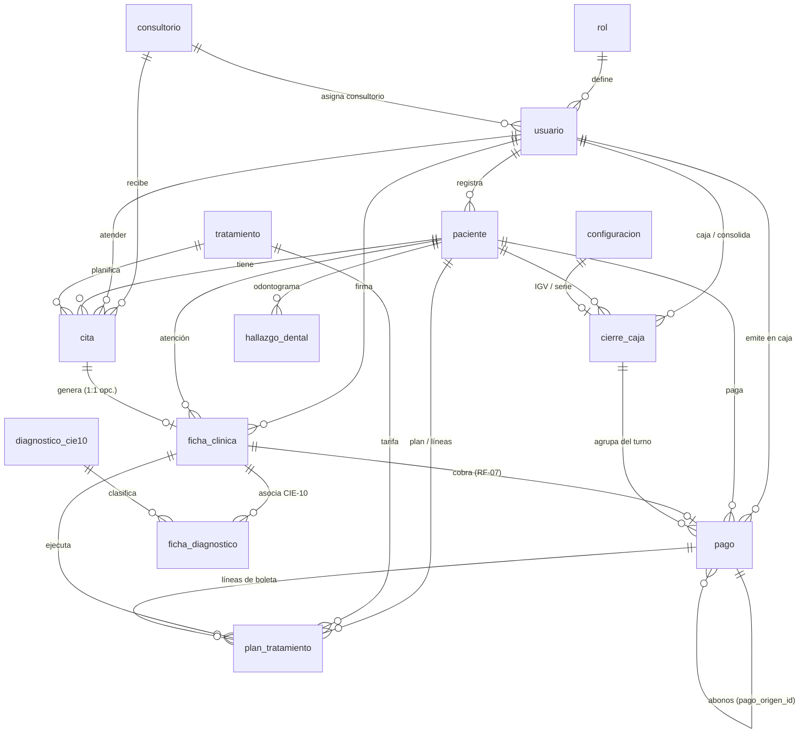

# Modelo de Datos — Dentrix Dental (PostgreSQL)

**Fecha:** 13/10/2026 · **Modelo v2 aprobado por la docente: 13 entidades + 1 unión = 14 tablas.**
Archivos: `Programa/sql/01_schema_v2.sql` (esquema) · `Programa/sql/02_datos_prueba_v2.sql` (semilla del 28/09/2026 + 6 casos duros).
La versión v1 (`01_schema.sql`, 21 tablas) se conserva como referencia histórica.

---

## 1. Diagrama Entidad-Relación (Mermaid)



## 2. Tablas y trazabilidad con módulos/RF

| Tabla | Módulo | RF / nota |
|---|---|---|
| `rol` | M1, M9.1 | RBAC real (3 roles: ADMINISTRADOR, ODONTOLOGO, RECEPCION) |
| `configuracion` | M9.3 | singleton `id = 1` (RUC, Chilca-Huancayo, IGV 18%, serie B001, horarios) |
| `consultorio` | M5, M9.3 | C01/C02 |
| `usuario` | M1, M2, M5, M8, M9.1 | **absorbe al odontólogo**: `colegiatura` (COP), `especialidad`, `consultorio_id`; `intentos_fallidos`/`bloqueado_hasta` → M1 |
| `paciente` | M4, M6 | **`dni UNIQUE`** (RF-04), `codigo_hc` HC-000001…, `alergias` (⚠ M4/M6), expediente en 1:1 |
| `diagnostico_cie10` | M9.2.2 | catálogo MINSA (RF-13), `es_frecuente` ⭐ |
| `tratamiento` | M9.2.1 | tarifario TRAT-01…05 (Pieza / Sesión / Mensual), RF-12 |
| `cita` | M2, M3, M5 | **bloques = filas `tipo <> 'CITA'`** (ALMUERZO/CIERRE/BLOQUEADO); UNIQUE (consultorio, fecha, hora) y UNIQUE (paciente, fecha, hora) |
| `ficha_clinica` | M6 | 1 fila = 1 sesión; `estado_derivacion` = **RF-07** (ACEPTADA habilita cobro) |
| `hallazgo_dental` | M6 | PK (paciente, pieza FDI 11–48 CHECK), estados de pieza |
| `cierre_caja` | M7.1 | turno del día; **`historial_fondos` JSONB** = RF-09 (100 → 200 por RC); `diferencia` columna GENERADA |
| `pago` | M2, M6, M7 | **`numero UNIQUE`** (B001-…); documento vs abono por `pago_origen_id`; **RF-08**: CHECK exige N° en Yape/Plin/Tarjeta; triggers de saldo |
| `plan_tratamiento` | M6, M7, M8 | 1 fila viaja PLANIFICADO → EJECUTADO → COBRADO; líneas de la boleta y ranking M8 |
| `ficha_diagnostico` | M6 | **N:N ficha × CIE-10**; PK (ficha, código); máx. 1 principal por ficha (trigger, RF-06) |

## 3. Vistas de reportes (M8)

| Vista | Alimenta |
|---|---|
| `v_kpis_dashboard` | KPIs de M2 (citados hoy, en sala, recaudación, deudores) |
| `v_saldos_paciente` | "Saldo Deudor" de M2 y deuda en M4/M6 |
| `v_ranking_tratamientos` | Top-5 tratamientos de M8 (cantidades, montos) |
| `v_productividad_odontologo` | Productividad por odontólogo de M8 |
| `v_ingresos_mes` | Ingresos por mes/modalidad de M8 |
| `v_no_show` | % de faltantes de M8 |

## 4. Decisiones de diseño

1. **Una fila de `plan_tratamiento` cruza todo el flujo**: lo planificado en M6 (PLANIFICADO), lo ejecutado en la sesión (EJECUTADO) y lo cobrado en la boleta (COBRADO) es la misma fila, enriquecida con `ficha_id` y `pago_id`. No hay doble registro clínico-financiero.
2. **Documento vs abono en la misma tabla `pago`**: `pago_origen_id IS NULL` = boleta con `numero`; NOT NULL = abono que reduce el saldo (RF-08). Un abono no puede apuntar a otro abono (trigger).
3. **Saldo por trigger**: emitir la boleta deja PENDIENTE con saldo = monto; cada abono recalcula y cambia a PARCIAL/PAGADO (la app solo llama a INSERT).
4. **Precios "con IGV incluido"**: el tarifario guarda el precio de mostrador (S/ 80); el trigger descompone `subtotal = monto/1.18` + `igv` (127.12 + 22.88 = 150.00).
5. **Bloques de agenda en `cita`**: almuerzo/cierre/bloqueados son filas con `tipo` propio; la UNIQUE de horario impide doble reserva y la grilla los pinta distintos.
6. **Odontólogo absorbido por `usuario`**: colegiatura/especialidad/consultorio como columnas; el rol ODONTOLOGO se valida en el servicio (un CHECK con subquery no es válido en PostgreSQL).
7. **Auditoría del fondo en JSONB** (RF-09): cada cambio de `fondo_inicial` agrega `{monto_anterior, monto_nuevo, motivo, fecha}` vía trigger.
8. **Un solo rol por usuario** (matriz M9.1): `jvallejos` = ADMINISTRADOR (también odontólogo), `jperez` = ODONTOLOGO, `ccampos` = RECEPCION.
9. **Contraseñas**: la semilla usa *placeholders* bcrypt; en producción se genera con `PasswordUtil`/jbcrypt (RNF-01) — nunca texto plano.

## 5. Semilla: el día 28/09/2026 (todo cuadra)

| Dato | Valor | Lámina |
|---|---|---|
| Citas | 5 atendibles + 4 bloques (Juan EN_ATENCION, Rosa/María EN_SALA, Pedro FALTO, Ana PENDIENTE) | M2/M3/M5 ✓ |
| Boleta de Juan | B001-000458 · TRAT-01 + TRAT-02 · **S/ 150** (127.12 + 22.88) | M6/M7 ✓ |
| Billeteras | 4 transferencias = **S/ 980** | M7.1 ✓ |
| Efectivo del turno | **S/ 1,250** | M7.1 ✓ |
| Gaveta | 200 (fondo) + 1,250 = **S/ 1,450**, diferencia **0** | M7.1 ✓ |
| Saldos por cobrar | B001-000440 (Juan, 500) + B001-000452 (Pedro, 160−10 = 150) = **S/ 650 (2 pac.)** | M2 ✓ |
| Recaudación del día | **S/ 2,230** (1,250 + 980) | M2 ✓ |
| Tarifario | TRAT-01…05 = 80/70/100/90/120 | M9.2.1 ✓ |

**Casos duros incluidos en la semilla** (imprimen `OK` al ejecutar): boleta de 2 líneas = 150 ·
abono 10 → saldo 150 PARCIAL · historial RF-09 100→200 · RF-07 bloquea facturar ficha PENDIENTE ·
RF-08 exige N° en Yape · RF-06 un solo diagnóstico principal. **Verificado: 6/6 OK (13/10/2026).**

## 6. Cómo ejecutarla

```bash
psql -U postgres -f sql/01_schema_v2.sql
psql -U postgres -f sql/02_datos_prueba_v2.sql
```

Comprobación rápida:
```sql
SET search_path TO dentrix;
SELECT numero, monto, saldo_deudor, estado_pago FROM pago ORDER BY numero;  -- 452 PARCIAL/150, resto PAGADO
SELECT * FROM v_kpis_dashboard;
SELECT fecha, efectivo_sistema, billeteras_sistema, diferencia FROM cierre_caja;  -- 2230 / dif 0
SELECT * FROM v_ranking_tratamientos;
```
